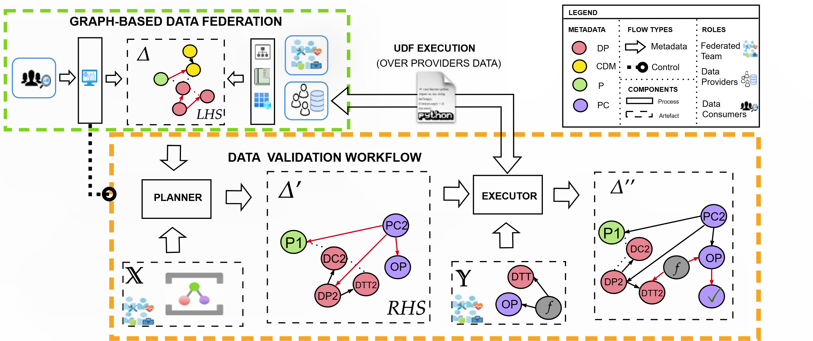

# Data Validation Workflow Engine

This repository provides the core **Executor** and **Planner** engine for automating data quality validation in federated data spaces. It is designed to be used as a submodule within a larger governance architecture.

## Overview

The engine operates in two main phases:

### 1. Planning Phase (PLANNER)
- **Input**: Data Product Metadata (RDF) + Data Quality Policies (ODRL/JSON-LD).
- **Process**: Uses N3 logic rules to reason over the metadata and policies.
- **Output**: A **PolicyChecker** graph (validation plan) that details the required validation operations.

### 2. Execution Phase (EXECUTOR)
- **Input**: The PolicyChecker graph generated by the Planner.
- **Process**: Dynamically binds abstract operations to executable Python code using `code_metadata.json`.
- **Output**: An Annotated Knowledge Graph containing validation reports (`dqv:QualityMeasurement`).

## Automated Validation Workflow

To translate conceptual Data Quality Requirement Patterns into executable computational governance, the architecture employs an end-to-end, ontology-driven validation pipeline.



This engine evaluates the specified ODRL policies over the target datasets automatically in four phases:

1. **Policy Binding (Data Contracts)**
   Physical datasets are bound to the overarching governance policies through standard Mapping Contracts. These contracts explicitly map physical, system-specific dataset columns to their corresponding abstract semantic features defined in the Common Data Model.

   ```mermaid
   flowchart LR
       A(Physical Column) -- dp1.json --> B{Semantic Feature}
       B -- common_data_models.json --> C(ODRL Policy)
       
       %% Example row
       A1([gender]) --> B1([ab:Sex])
       B1 --> C1([DQRP6])
   ```

2. **Semantic Planning & Constraint Propagation (`planner.py`)**
   The `planner.py` uses semantic logic to evaluate the **ODRL (Open Digital Rights Language)** Policies associated with the dataset's contract. It leverages **N3 graph transformation rules** (e.g., `rules_n3/Completeness.n3`, `rules_n3/Validity.n3`, `rules_n3/Fairness.n3`) to automatically reason over the policy's Quality Dimensions.
   
   A key mechanism here is **Constraint Propagation**: the engine traces the ODRL constraints defined on abstract concepts (e.g., `ab:Sex`) through the data contracts down to the exact physical column names (e.g., `gender`). These rules translate the abstract governance goals (like checking if an ODRL `leftOperand` meets a `rightOperand` threshold) into a sequence of operational execution instructions.

   **Example N3 Rule (Fairness propagation):**
   ```n3
   {
       # If the ODRL Policy defines a "Fairness" data quality dimension...
       ?policy tb:qualityDimension "Fairness" .
       ?permission odrl:constraint ?constraint .
       ?permission tb:physicalAttribute ?targetAttr .
   } => {
       # ...Then emit an abstract instruction to calculate Fairness max percentages.
       _:fairnessOp a tb:Operation ;
                    tb:hasAbstract ab:qM_Fairness ;
                    tb:hasInput [ tb:value ?targetAttr ; tb:role "targetAttribute" ] ;
                    tb:hasOutput ab:score .
   } .
   ```

3. **Execution (`executor.py`)**
   The `executor.py` script interprets the output of the Planner and cross-references an implementation catalog (`code_metadata.json` and `parameter_binding_semantic.n3`). This metadata catalogs the available backend execution capabilities matching the abstract instructions. It dynamically generates localized, standalone User-Defined Functions (UDFs) tailored to verify the data mathematically (such as computing class percentage balance for Fairness, or verifying standard string formats using libraries like `pycountry`).

   **Example capabilities indexed in `code_metadata.json`:**
   ```json
   {
     "@id": "ab:ImpQualityMetricValidity",
     "@type": "tb:Implementation",
     "rdfs:comment": "Validity check - percentage of values adhering to ISO 3166 alpha-2",
     "tb:forOp": [ { "@id": "ab:qM_Validity" } ],
     "tb:hasCode": [
       { "tb:code": "(data[attr].astype(str).str.upper().isin({country.alpha_2 for country in __import__('pycountry').countries})).sum() / len(data) * 100" }
     ],
     "tb:dependsOn": [ { "tb:name": "pandas" }, { "tb:name": "pycountry" } ]
   }
   ```

4. **Result Reporting for Audibility**
   The continuous UDF execution directly tests the underlying datasets. Upon completion, the executor merges the logical validation status (`PASSED`/`FAILED`), runtime metrics, and the raw composed Python code of the UDF itself back into the overarching Semantic Data Model Infrastructure for explicit audibility tracking.

## Repository Structure

| Folder      | Description                                                                  |
| ----------- | ---------------------------------------------------------------------------- |
| `executor/` | Python implementation (`executor.py`) and `code_metadata.json`               |
| `planner/`  | Python implementation (`planner.py`) and N3 reasoner wrapper                 |
| `rules_n3/` | The core logic rules (N3) for generating validation plans (Timeliness, etc.) |

## Usage

This repository is typically used as a submodule. Key scripts:

- **Planner**: `python planner/planner.py <path_to_sdm> <data_product_name>`
- **Executor**: `python executor/executor.py <policy_checker_uri> <code_metadata_path>`
